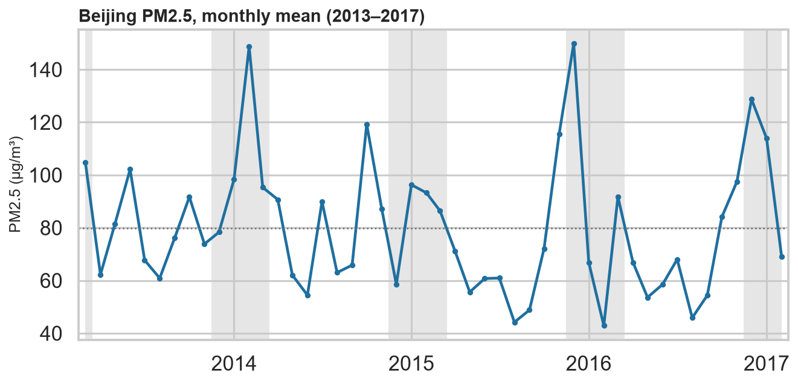
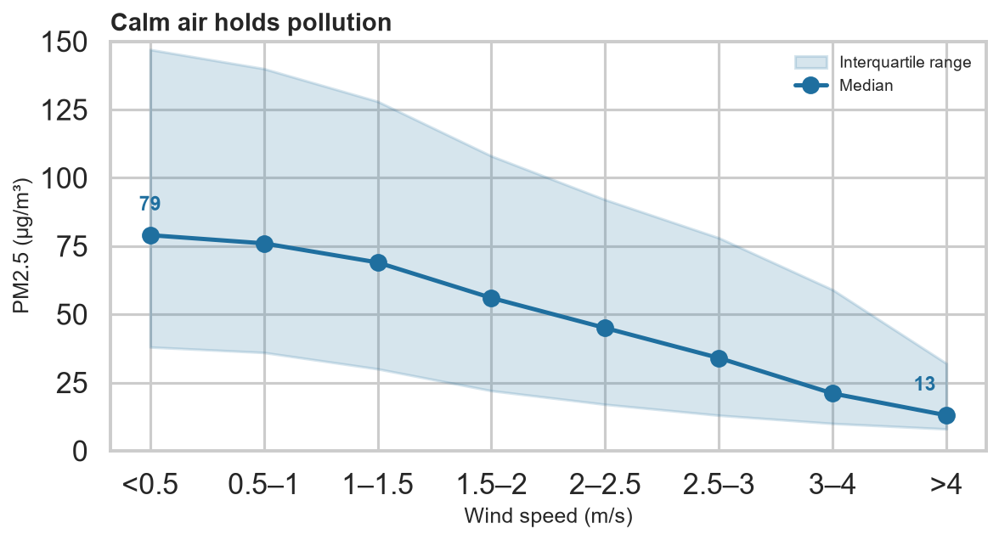

I am a graduate student at the University of Macau, currently taking **CISC7204 Data Science**.
I enjoy questions that can be answered with public data, a reproducible notebook, and a figure
someone can read in ten seconds. This site collects the projects I am building along the way.

## About me

My work focuses on exploratory data analysis, statistical reasoning and machine learning with
Python. I care about data quality before modelling, and about honest error bars afterwards: a
model that is clear about what it cannot explain is more useful than one that is not.

I am especially interested in applying these skills to environmental and public-policy data.

## Technical skills

| Area | Tools |
|---|---|
| Data wrangling | Python, pandas, NumPy |
| Visualisation | matplotlib, seaborn, Plotly |
| Modelling | scikit-learn (regression, random forests), statsmodels |
| Workflow | Jupyter, Git/GitHub, reproducible analysis |

## Project showcase

### When does Beijing breathe easiest?

**Research question.** How does fine particulate matter (PM2.5) in Beijing vary across seasons,
hours and monitoring stations — and how much of that variation can the weather explain?

*Figure 1. City-wide monthly mean PM2.5, March 2013 – February 2017. Grey bands mark the heating
season (15 November – 15 March); the dotted line is the four-year mean (80 µg/m³). Winter peaks do
not decline over the four years.*

**What the data show.** Across 420,768 hourly records from 12 stations, PM2.5 is strongly seasonal
(December 105 µg/m³ vs August 54 µg/m³), peaks on winter nights rather than at the morning rush
hour, and differs by about 20 µg/m³ between the cleanest and dirtiest stations. Wind is the
sharpest weather gradient: the median is 79 µg/m³ in calm hours and 13 µg/m³ when wind exceeds
4 m/s.

*Figure 2. PM2.5 by wind-speed bin. Points are medians; the band is the interquartile range.
Calm hours are roughly six times more polluted than the windiest hours.*

A random forest using weather, calendar and station features reaches **R² = 0.56** on a held-out
year (RMSE 58 µg/m³) — useful, but a reminder that emissions, not weather, remain the main lever.
The full analysis, including the data-quality checks, the station comparison and the model
diagnostics, is in the repository.

**Status:** Completed

**Code and full analysis:** [data-science-project](https://github.com/875711671yao-hash/data-science-project)

## What I am working on next

- Adding lagged PM2.5 and traffic data to test whether the winter rebound survives a causal design.
- Turning the figures into a small interactive dashboard.
- Building two more case studies so the portfolio shows range, not a single project.

---

*Data: Beijing Multi-Site Air Quality Data, UCI Machine Learning Repository #501 (CC BY 4.0).
Built with GitHub Pages. Last updated October 2026.*
